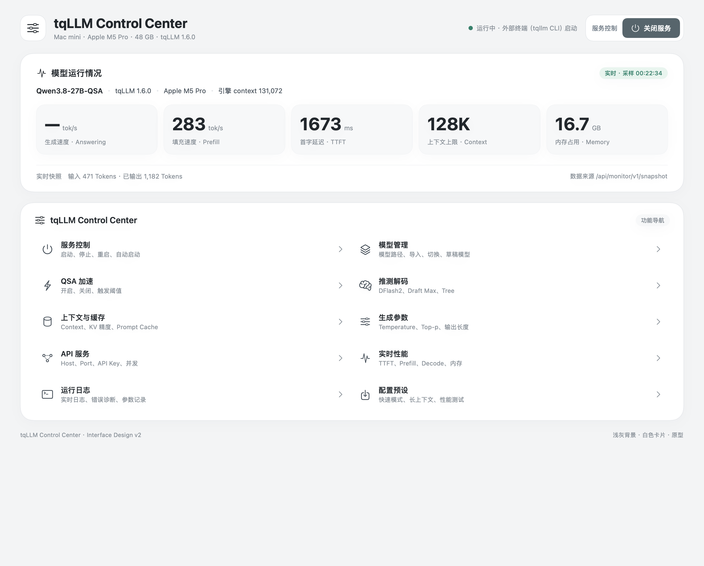
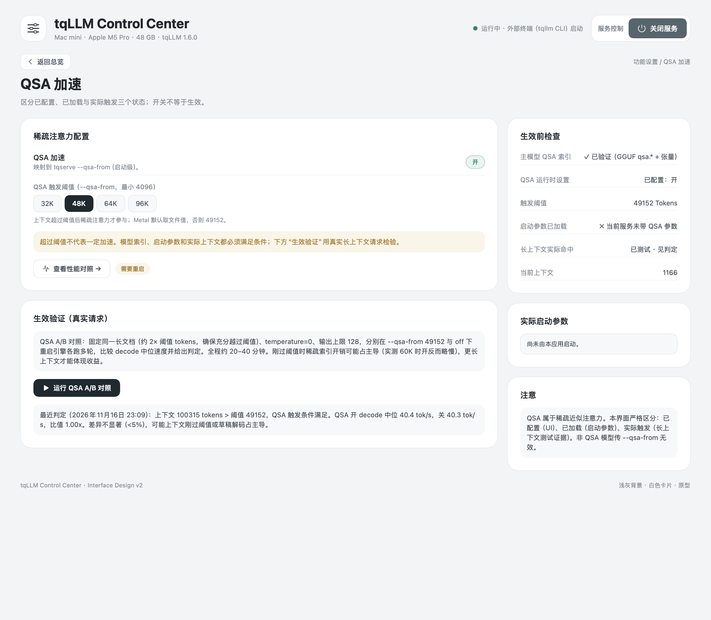
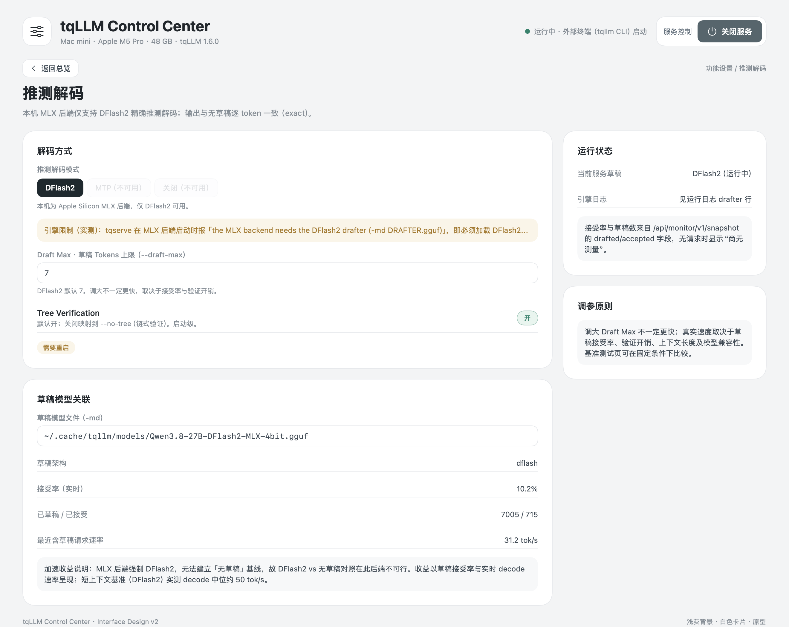
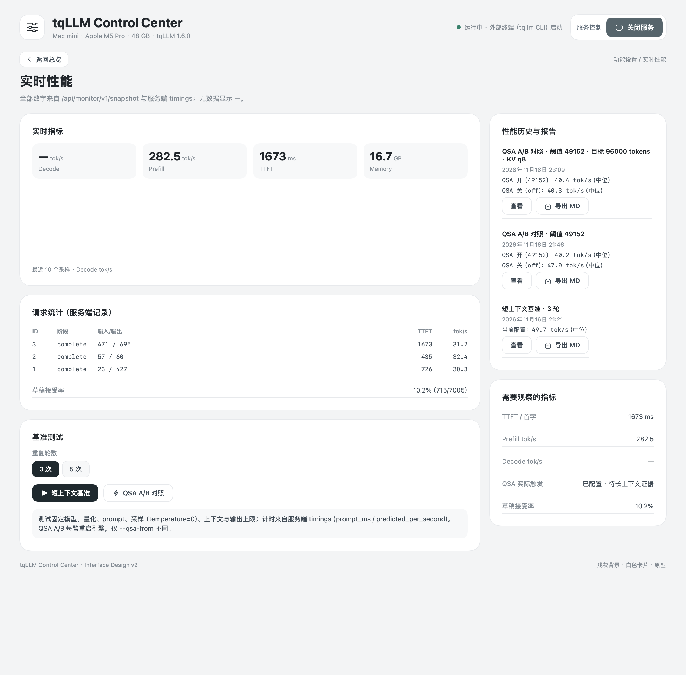

# tqLLM Control Center

**A native macOS control panel for the [tqLLM](https://github.com/turbo-tan/tqllm) inference engine — service control, model management, QSA acceleration, speculative decoding, live performance monitoring and benchmarking, all in a clean SwiftUI app.**

> 中文：基于 tqLLM 的 macOS 原生图形化管理器。服务启停、模型管理、QSA 加速、推测解码、实时监控与性能对照测试。详见 [使用说明](docs/USAGE.md) / [参数映射](docs/PARAMETER_MAPPING.md) / [测试报告](docs/TEST_REPORT.md)。




-lightgrey)


---

## What is this?

[tqLLM](https://github.com/turbo-tan/tqllm) is a fast C++/MLX inference engine for open-weight models on Apple Silicon and NVIDIA GPUs, with an OpenAI-compatible API. It is driven by a CLI (`tqllm` / `tqserve`).

**tqLLM Control Center** is a companion GUI that wraps the engine so you can configure and monitor it without memorizing flags. It does **not** re-implement the engine and does **not** download models — it manages your existing local tqLLM installation and GGUF files.

Every UI control maps to a real, verified `tqserve` parameter or API endpoint. Unsupported features are disabled and explained, never faked. See the [parameter mapping](docs/PARAMETER_MAPPING.md) for the full control↔flag table.

## Features

- **Home dashboard** — live Decode / Prefill tok/s, TTFT, context, memory; global start / stop / restart. No data shows `—`, never fabricated.
- **Service control** — start/stop/restart, CLI detection, launch-argument preview, login auto-start (`SMAppService`), health check. Stops only the engine it owns (via official `tqllm stop`, pid-scoped — never `pkill`).
- **Model management** — scan GGUF metadata (architecture, quantization, QSA index tensors, MTP head, drafter), switch main/draft models, external-disk status.
- **QSA acceleration** — toggle + threshold (`--qsa-from`), three-state verification (configured → loaded → actually triggered), and a built-in long-context **A/B benchmark** with a KV-consistency guard.
- **Speculative decoding** — DFlash2 (`-md`, `--draft-max`, tree verify), live draft acceptance rate.
- **Context & cache** — context length, KV precision, prompt cache, memory fit; shows requested vs. actually-loaded values.
- **Generation params** — temperature / top-p / top-k / max tokens / thinking mode (request-level), with a live test request.
- **API service** — host / port / API key (stored in **macOS Keychain**) / concurrency, endpoint copy, Tailscale address helper.
- **Live performance** — real-time chart, request statistics, short-context benchmark, QSA A/B, persistent reports + Markdown export.
- **Logs** — incremental tail of the official `server.log` + app events, filtering, diagnostics, export.
- **Presets** — daily / long-context / benchmark + custom save, JSON import/export (no secrets).

## Requirements

- macOS 14+ on **Apple Silicon** (the engine's MLX backend).
- A working [tqLLM](https://tqllm.com/install.html) installation (default `~/.tqllm/venv/bin/tqllm`).
- Your own GGUF model files (e.g. a Qwen3.8-27B TQ/QSA build). The app references them in place; it never moves or re-downloads them.

## Install

**From source** (CommandLineTools is enough; full Xcode not required):

```bash
git clone https://github.com/fhekg/tqllm-control-center.git
cd tqllm-control-center
./make_app.sh                 # builds + bundles + ad-hoc signs
open "build/tqLLM Control Center.app"
# or install:
cp -R "build/tqLLM Control Center.app" /Applications/
```

> **Gatekeeper:** the app is ad-hoc signed (not notarized). On first launch macOS may say "cannot verify the developer". Right-click → Open, or run `xattr -dr com.apple.quarantine "/Applications/tqLLM Control Center.app"`.

On first launch, set your CLI path and model files in **Model Management**, then start the service from the top toolbar.

## Build notes

- The repo builds with Apple **CommandLineTools** alone. Because CLT ships without Apple's `SwiftUIMacros` plugin, `@State` is expanded manually (storage + accessors + `projectedValue`) — valid Swift that also builds fine under full Xcode.
- `build.sh` / `make_app.sh` set a local module-cache path; `build_ctl.sh` builds `tqllmctl`, a headless CLI that shares the exact service-layer code (useful for scripting and integration tests).

```bash
./build.sh release      # GUI binary
./build_ctl.sh          # headless tqllmctl
./make_app.sh           # .app bundle
build/tqllmctl scan|start|stop|status|snapshot|bench-short|bench-ab|reports
```

## Architecture

```
Sources/
  App / HomeView / *View.swift      UI layer (SwiftUI)
  AppConfig / ConfigStore           config + presets (Keychain for secrets)
  EngineController                  process control (direct tqserve supervision)
  ModelScanner / GGUF               model scan + capability detection
  APIClient / MonitorService        API + live telemetry
  BenchmarkService                  benchmarks + report persistence
  LogService                        log tail + diagnostics
SourcesCLI/                         headless integration CLI (same service layer)
```

The adapter talks to `tqserve` **directly** (not through `tqllm serve`), so each UI switch maps to exact argv. The CLI auto-injects a default DFlash2 drafter, which would make a "no drafter" switch dishonest — direct supervision avoids that.

## Screenshots

| QSA verification | Speculative decoding | Live performance |
|---|---|---|
|  |  |  |

## Honest limitations (measured, not guessed)

- **MLX backend requires the DFlash2 drafter.** On Apple Silicon, `tqserve` refuses to start without `-md` (`the MLX backend needs the DFlash2 drafter`). So "no drafter" and `--mtp` are **unavailable** on this backend and are disabled in the UI. DFlash2 is exact speculative decoding (output identical token-for-token).
- **QSA benefit is workload/hardware dependent.** On a Qwen3.8-27B hybrid-attention model on M5 Pro, controlled A/B tests measured **0.86× at 60K** (indexer overhead just past threshold) and **1.00× at 100K** (no significant decode gain). QSA is correctly loaded and triggered, but net acceleration was not observed at these lengths on this hardware. The app reports this truthfully. See [TEST_REPORT.md](docs/TEST_REPORT.md).
- **Memory Fit may change KV precision per request** under memory pressure; the A/B benchmark pins KV and guards against drift.
- Metal `tqserve` exposes no GPU/RAM telemetry; memory is read from the engine process footprint (`proc_pid_rusage`).

## Credits

- [tqLLM](https://github.com/turbo-tan/tqllm) by turbo-tan — the inference engine (Apache-2.0).
- Qwen3.8-27B TQ/QSA GGUF builds by [YTan2000](https://huggingface.co/YTan2000); base model by Qwen (Apache-2.0).
- [DFlash2](https://huggingface.co/z-lab/Qwen3.8-27B-DFlash2) drafter by z-lab.

This project is an independent companion tool, not an official turbo-tan product.

## License

[Apache-2.0](LICENSE). Model weights keep their own licenses.